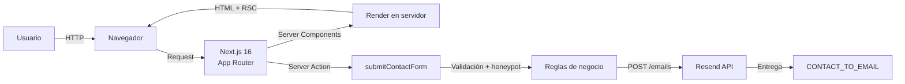
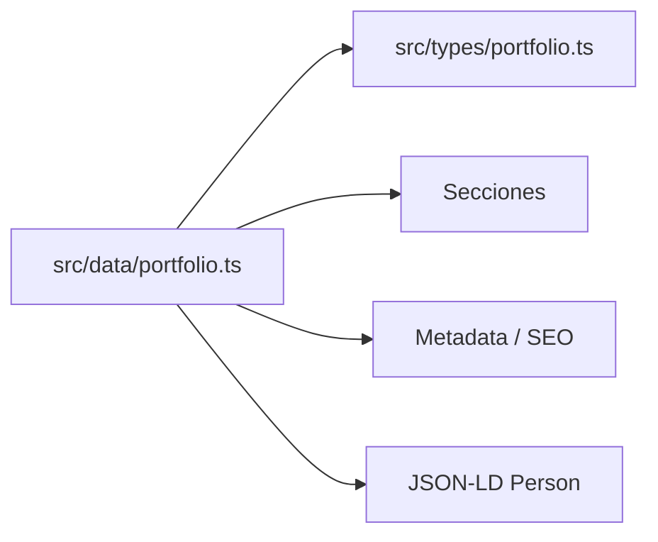
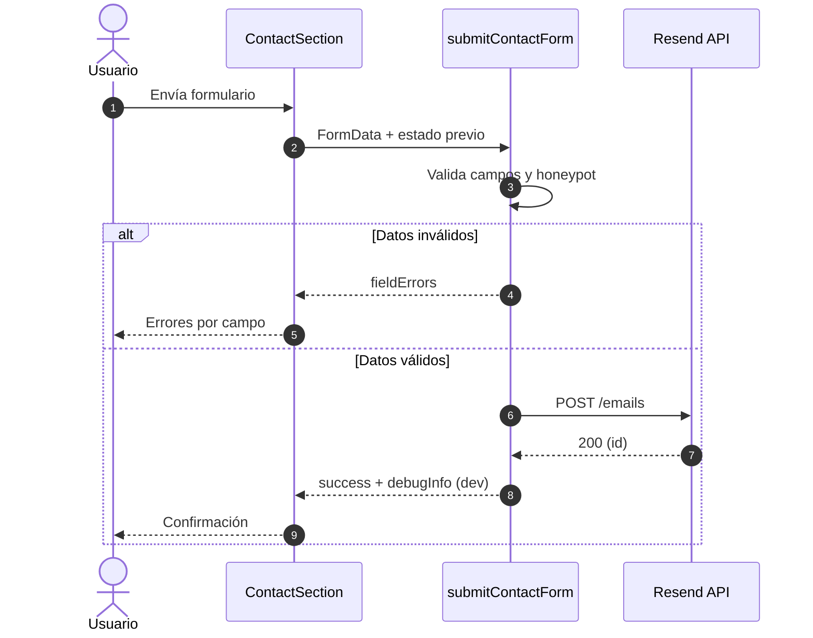

<p align="center">
  
</p>

<h1 align="center">Portafolio Web · David Alexis</h1>

<p align="center">
  Aplicación de una sola página construida con <strong>Next.js 16 (App Router)</strong>, <strong>React 19</strong>, <strong>TypeScript</strong>, <strong>Tailwind CSS 4</strong>, <strong>Motion</strong> y envío de correo con <strong>Resend</strong>.
</p>

<p align="center">
  <a href="https://nextjs.org/"></a>
  <a href="https://react.dev/"></a>
  <a href="https://www.typescriptlang.org/"></a>
  <a href="https://tailwindcss.com/"></a>
  <a href="https://motion.dev/"></a>
  <a href="https://resend.com/"></a>
  <a href="https://nodejs.org/">= 20.9" /></a>
  <a href="https://pnpm.io/"></a>
</p>

<p align="center">
  <a href="LICENSE"></a>
  <a href="https://github.com/NarcisoDMC/Developer-Portfolio/commits/main"></a>
  <a href="https://github.com/NarcisoDMC/Developer-Portfolio"></a>
</p>

---

## Resumen técnico

- **Aplicación estática con una Server Action:** no hay base de datos, autenticación ni CMS. El contenido vive en `src/data/portfolio.ts` y el único proceso de escritura es el formulario de contacto.
- **Renderizado server-first:** `layout.tsx` y `page.tsx` son Server Components; los componentes que necesitan motion, estado local o APIs del navegador son Client Components.
- **Formulario con Server Action:** validación en servidor, honeypot anti-spam, timeout de 10 s y llamada directa a la API REST de Resend.
- **Calidad integrada:** cabeceras de seguridad en `next.config.ts`, metadata/Open Graph/Twitter, JSON-LD, `robots.txt`, `sitemap.xml`, imágenes AVIF/WebP y animaciones con `prefers-reduced-motion`.

---

## Stack

| Capa | Tecnología | Versión | Uso |
| --- | --- | --- | --- |
| Runtime | Node.js | `>= 20.9.0` | Requerido por Next.js 16. |
| Framework | Next.js | `16.4.6` | App Router, Server Components, Server Actions, Metadata API. |
| UI | React | `19.3.1` | Componentes, `useActionState`, estado local. |
| Lenguaje | TypeScript | `^5.8.0` | Tipos estrictos del contenido y de las props. |
| Estilos | Tailwind CSS | `^4.3.5` | Utilidades, tokens CSS y CSS por componente. |
| Animación | Motion | `^14.14.0` | Scroll reveals, transiciones, progreso de scroll. |
| Correo | Resend API | REST | `POST https://api.resend.com/emails`. |
| Fuentes | `next/font` | — | Inter + JetBrains Mono con `display: swap`. |
| Paquetes | pnpm | `9+` | Lockfile `9.0`. |
| Lint | ESLint | `^9.39.0` | `eslint-config-next`. |

### Dependencias principales

```json
{
  "next": "16.4.6",
  "react": "19.3.1",
  "react-dom": "19.3.1",
  "motion": "^14.14.0"
}
```

No hay librería de UI, gestor de estado global, ORM ni cliente HTTP adicional. El formulario usa `fetch` nativo y la API de Resend directamente.

---

## Arquitectura



### Límites cliente/servidor

| Archivo | Tipo | Responsabilidad |
| --- | --- | --- |
| `src/app/layout.tsx` | Server | Metadata, fuentes, `MotionProvider`, header, footer y skip link. |
| `src/app/page.tsx` | Server | Composición de secciones y JSON-LD `Person`. |
| `src/components/ui/SectionHeading.tsx` | Server | Encabezado presentacional sin estado. |
| `src/components/layout/SiteHeader.tsx` | Client | Scroll, sección activa y menú móvil. |
| `src/components/layout/SiteFooter.tsx` | Client | Enlaces animados. |
| `src/components/motion/ScrollReveal.tsx` | Client | `useScroll`, `useSpring`, `useTransform` y `useReducedMotion`. |
| `src/components/sections/*` | Client | Motion, estado local, diálogo de proyecto y formulario. |
| `src/components/sections/ProjectDetailDialog.tsx` | Client | `<dialog>` nativo, foco, cierre animado y `AnimatePresence`. |

La separación busca que el HTML inicial se genere en servidor y que el JavaScript de cliente quede acotado a las secciones interactivas.

### Flujo de contenido



`portfolio.ts` es la fuente única de verdad. Los tipos de `types/portfolio.ts` validan la forma del contenido en tiempo de compilación; no hay fetching de contenido en runtime.

---

## Flujo del formulario



### Reglas de validación

| Campo | Regla |
| --- | --- |
| `name` | Entre 2 y 100 caracteres. |
| `email` | Formato válido, máximo 160 caracteres, sin `\r` ni `\n`. |
| `message` | Entre 10 y 3000 caracteres. |
| `hp_field_check` | Honeypot: debe estar vacío. Si tiene contenido, el envío se descarta silenciosamente. |

### Payload enviado a Resend

```json
{
  "from": "Portafolio <onboarding@resend.dev>",
  "to": ["CONTACT_TO_EMAIL"],
  "reply_to": "correo-del-visitante@ejemplo.com",
  "subject": "[Portafolio] Nuevo mensaje de <nombre>",
  "text": "Nombre: ...\nCorreo: ...\n\nMensaje:\n..."
}
```

- `from` sale de `CONTACT_FROM_EMAIL` o del valor por defecto `Portafolio <onboarding@resend.dev>`.
- `to` sale de `CONTACT_TO_EMAIL`.
- `reply_to` es el correo escrito por el visitante; no se usa como remitente.
- La petición usa `AbortSignal.timeout(10000)`.

### Diagnóstico en desarrollo

La Server Action registra un `requestId` y devuelve `debugInfo.stage` solo en desarrollo:

| Stage | Significado |
| --- | --- |
| `resend-sent` | Resend aceptó el correo; incluye `emailId`. |
| `resend-http-error` | Resend respondió con error HTTP; incluye `resendStatus` y el mensaje. |
| `resend-network-exception` | Falló la conexión o se agotó el timeout. |
| `honeypot-blocked` | El campo oculto venía relleno. |
| `missing-env-demo-fallback` | Faltan variables de entorno; no se envió correo. |

> `onboarding@resend.dev` es el remitente de pruebas de Resend y solo puede enviar al correo dueño de la cuenta. Para producción se debe verificar un dominio y configurar `CONTACT_FROM_EMAIL`.

---

## Estructura del proyecto

```text
.
├─ public/
│  └─ images/
│     ├─ profile-david.jpg
│     └─ projects/
│        ├─ cosmolight-logo.svg
│        ├─ librerio-logo.svg
│        └─ optigo-logo.svg
├─ src/
│  ├─ app/
│  │  ├─ actions/
│  │  │  └─ contact.ts          # Server Action + Resend
│  │  ├─ globals.css
│  │  ├─ layout.tsx             # Metadata, fuentes y shell
│  │  ├─ page.tsx               # Composición + JSON-LD
│  │  ├─ robots.ts
│  │  └─ sitemap.ts
│  ├─ components/
│  │  ├─ layout/                # Header, footer, skip link
│  │  ├─ motion/                # MotionProvider y scroll reveals
│  │  ├─ sections/              # Secciones de la página
│  │  └─ ui/                    # Componentes reutilizables
│  ├─ data/
│  │  └─ portfolio.ts           # Contenido tipado
│  ├─ styles/
│  │  └─ tokens.css             # Variables de diseño
│  └─ types/
│     └─ portfolio.ts           # Contratos de datos
├─ next.config.ts               # Imágenes y cabeceras de seguridad
├─ package.json
├─ pnpm-lock.yaml
└─ tsconfig.json
```

---

## Variables de entorno

Crea `.env.local` en la raíz. Está cubierto por `.gitignore` y no debe subirse.

```env
RESEND_API_KEY=re_xxxxxxxxxxxxxxxxxxxxxxxxx
CONTACT_TO_EMAIL=tu-correo@dominio.com
CONTACT_FROM_EMAIL=Portafolio <contacto@tudominio.com>
NEXT_PUBLIC_SITE_URL=https://davidalexis.dev
```

| Variable | Obligatoria | Ámbito | Uso |
| --- | --- | --- | --- |
| `RESEND_API_KEY` | Sí | Servidor | Autentica `POST /emails`. Nunca debe exponerse al cliente. |
| `CONTACT_TO_EMAIL` | Sí | Servidor | Destinatario de los mensajes. |
| `CONTACT_FROM_EMAIL` | No | Servidor | Remitente verificado. Default: `Portafolio <onboarding@resend.dev>`. |
| `NEXT_PUBLIC_SITE_URL` | No | Cliente/servidor | `metadataBase`, `robots.txt` y `sitemap.xml`. Default: `https://davidalexis.dev`. |

---

## Puesta en marcha

### Requisitos

- Node.js `>= 20.9.0`
- pnpm `9+`

### Instalación y desarrollo

```bash
pnpm install
pnpm dev
```

Disponible en [http://localhost:3000](http://localhost:3000).

### Scripts

| Comando | Descripción |
| --- | --- |
| `pnpm dev` | Servidor de desarrollo. |
| `pnpm build` | Build de producción. |
| `pnpm start` | Sirve la build de producción. |
| `pnpm lint` | ESLint. |

Actualmente no hay suite de tests automatizados; los controles disponibles son `pnpm lint` y `pnpm build`.

---

## Build y despliegue

```bash
pnpm build
pnpm start
```

Para Vercel:

1. Importar el repositorio.
2. Configurar `RESEND_API_KEY`, `CONTACT_TO_EMAIL`, `CONTACT_FROM_EMAIL` y `NEXT_PUBLIC_SITE_URL`.
3. Build command: `pnpm build`.
4. Verificar que `NEXT_PUBLIC_SITE_URL` apunte al dominio final.

`.env.local` no se despliega; las variables deben configurarse en el panel de la plataforma.

---

## Seguridad

`next.config.ts` aplica estas cabeceras a todas las rutas:

| Cabecera | Valor |
| --- | --- |
| `X-Frame-Options` | `DENY` |
| `X-Content-Type-Options` | `nosniff` |
| `Referrer-Policy` | `strict-origin-when-cross-origin` |
| `Permissions-Policy` | `camera=(), geolocation=(), microphone=()` |
| `Cross-Origin-Opener-Policy` | `same-origin-allow-popups` |
| `Cross-Origin-Resource-Policy` | `same-origin` |
| `Content-Security-Policy` | `frame-ancestors 'none'; object-src 'none'; base-uri 'none'; form-action 'self'` |

Además:

- `poweredByHeader: false`.
- La API key solo se lee en la Server Action; no llega al bundle del cliente.
- El formulario combina validación server-side y honeypot.
- El JSON-LD escapa `<` como `\u003c` antes de inyectarse con `dangerouslySetInnerHTML`.
- `.env*` está ignorado por Git, salvo `.env.example`.

---

## Rendimiento

- **Server-first:** `layout.tsx` y `page.tsx` se renderizan en servidor; el cliente solo hidrata las secciones que lo necesitan.
- **Sin fetching de contenido:** `portfolio.ts` se importa en build/runtime de servidor; no hay llamadas a APIs externas para renderizar la página.
- **Imágenes:** `next/image` para la foto de perfil y formatos `image/avif` + `image/webp` en `next.config.ts`.
- **Fuentes:** `next/font` con `display: swap` y variables CSS para Inter y JetBrains Mono.
- **CSS:** tokens propios en `src/styles/tokens.css` + Tailwind; sin librería de componentes.
- **Motion:** `MotionConfig reducedMotion="user"` y `useReducedMotion` evitan animaciones cuando el usuario lo solicita.

---

## Accesibilidad

- `SkipLink` para saltar al contenido principal.
- Secciones con `aria-labelledby`, `tabIndex={-1}` y encabezados semánticos.
- Formulario con `aria-invalid`, `aria-describedby`, región `role="status"` y foco en el primer campo inválido.
- `ProjectDetailDialog` usa `<dialog>` nativo, `showModal()`, manejo de foco y cierre con teclado.
- Iconos decorativos con `aria-hidden="true"` y etiquetas accesibles donde corresponde.
- Animaciones desactivables con `prefers-reduced-motion`.

---

## SEO

- Metadata API en `src/app/layout.tsx`: título con template, descripción, keywords, autor y `metadataBase`.
- Open Graph y Twitter Cards configurados.
- JSON-LD `Person` en `src/app/page.tsx`, con `sameAs` y `knowsAbout` derivado de los pilares del stack.
- `src/app/robots.ts` genera `robots.txt`.
- `src/app/sitemap.ts` genera `sitemap.xml`.
- `NEXT_PUBLIC_SITE_URL` controla la URL base de metadata, robots y sitemap.

---

## Proyectos

| Proyecto | Stack | Enlaces |
| --- | --- | --- |
| <br />**OptiGo AI** | Django · Next.js · OR-Tools · DeepSeek | [Repositorio](https://github.com/alo-py/Reto-Infosys) |
| <br />**Librerio App** | Next.js · Express · TypeScript · Supabase | [Demo](https://librerio-app.vercel.app/) · [Repositorio](https://github.com/NarcisoDMC/LibrerioApp-Official) |
| <br />**CosmoLights** | Python · React · Serial/USB | [Repositorio](https://github.com/NarcisoDMC/CosmoLights) |

---

## Licencia

GNU General Public License v3.0. Consulta [LICENSE](LICENSE).
