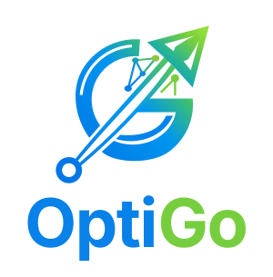

<p align="center">
  
</p>

<h1 align="center">David Alexis · Portafolio Web</h1>

<p align="center">
  <strong>Ingeniero en Sistemas Computacionales · Full-Stack & AI Engineer</strong><br />
  Portafolio personal construido con Next.js 16, React 19 y TypeScript.
</p>

<p align="center">
  <a href="https://nextjs.org/"></a>
  <a href="https://react.dev/"></a>
  <a href="https://www.typescriptlang.org/"></a>
  <a href="https://tailwindcss.com/"></a>
  <a href="https://motion.dev/"></a>
  <a href="https://resend.com/"></a>
  <a href="https://nodejs.org/">= 20.9" /></a>
  <a href="https://pnpm.io/"></a>
</p>

<p align="center">
  <a href="https://github.com/NarcisoDMC/Developer-Portfolio/blob/main/LICENSE"></a>
  <a href="https://github.com/NarcisoDMC/Developer-Portfolio/commits/main"></a>
  <a href="https://github.com/NarcisoDMC/Developer-Portfolio"></a>
</p>

---

## Sobre el proyecto

Portafolio profesional de una sola página para presentar proyectos, stack técnico, experiencia con código abierto y vías de contacto. Está construido con el **App Router de Next.js**, componentes de servidor por defecto, Server Actions para el formulario y una capa visual propia sobre CSS moderno y Tailwind CSS.

El sitio prioriza tres cosas:

- **Rendimiento:** menos JavaScript en cliente, fuentes optimizadas, imágenes en AVIF/WebP y animaciones que respetan `prefers-reduced-motion`.
- **Accesibilidad:** navegación por teclado, skip link, regiones semánticas, estados de error anunciados y contraste cuidado.
- **Mantenibilidad:** contenido centralizado en `src/data/portfolio.ts`, tipos estrictos y componentes separados por responsabilidad.

### Secciones

| Sección | Contenido |
| --- | --- |
| **Hero** | Presentación, rol, foto de perfil y llamadas a la acción. |
| **Proyectos** | Casos destacados con arquitectura, retos, impacto, stack y enlaces. |
| **Stack** | Pilares técnicos: frontend, backend/datos, IA/optimización y sistemas/hardware. |
| **GitHub** | Perfil, áreas de enfoque y banner de **Whenly App** (próximamente). |
| **Contacto** | Datos profesionales y formulario con envío real por correo. |

---

## Stack tecnológico

| Área | Tecnologías |
| --- | --- |
| **Framework** | Next.js 16 (App Router, Server Components, Server Actions) |
| **UI** | React 19, TypeScript 5.8, Tailwind CSS 4, CSS Grid/Subgrid |
| **Animación** | Motion 14 (`motion/react`), scroll reveals, barra de progreso |
| **Formularios** | Server Actions, validación en servidor, honeypot anti-spam |
| **Correo** | Resend API (`POST /emails`) con `reply_to` y timeout de 10 s |
| **Tipografía** | `next/font` con Inter y JetBrains Mono, `display: swap` |
| **Herramientas** | pnpm, ESLint 9, TypeScript estricto |
| **SEO** | Metadata API, Open Graph, Twitter Cards, `robots.txt`, `sitemap.xml` |
| **Seguridad** | Cabeceras HTTP en `next.config.ts`, CSP parcial, `poweredByHeader: false` |

---

## Proyectos destacados

<table>
  <tr>
    <td align="center" width="120" bgcolor="#0b1020">
      
    </td>
    <td>
      <h3>OptiGo AI</h3>
      <p><strong>HackMTY 2025 · Reto Infosys</strong></p>
      <p>Sistema de despacho y simulación para repartidores independientes mediante IA. Motor VRP con restricciones de capacidad y prioridad, asistente analítico con DeepSeek y panel operativo en Next.js.</p>
      <p><code>Django</code> <code>Next.js</code> <code>OR-Tools</code> <code>DeepSeek</code></p>
      <p><a href="https://github.com/alo-py/Reto-Infosys">Ver repositorio en GitHub →</a></p>
    </td>
  </tr>
  <tr>
    <td align="center" width="120" bgcolor="#0b1020">
      
    </td>
    <td>
      <h3>Librerio App</h3>
      <p><strong>Plataforma social de lectura · 2025</strong></p>
      <p>Comunidad lectora con asistente conversacional consciente del progreso de lectura, estanterías colaborativas, reseñas y recomendaciones sin spoilers. Frontend SSR/RSC en Next.js, API REST en Express y persistencia con Supabase.</p>
      <p><code>Next.js</code> <code>Express</code> <code>TypeScript</code> <code>Supabase</code></p>
      <p><a href="https://librerio-app.vercel.app/">Ver demo →</a></p>
    </td>
  </tr>
  <tr>
    <td align="center" width="120" bgcolor="#0b1020">
      
    </td>
    <td>
      <h3>CosmoLights</h3>
      <p><strong>Controlador de hardware open source · 2025</strong></p>
      <p>Daemon de comunicación serial en Python y una interfaz reactiva en React para controlar iluminación física con baja latencia: escenas, perfiles de color y sincronización en vivo.</p>
      <p><code>Python</code> <code>React</code> <code>Serial / USB</code></p>
      <p><a href="https://github.com/NarcisoDMC">Ver perfil en GitHub →</a></p>
    </td>
  </tr>
</table>

---

## Características principales

- **Formulario de contacto funcional** con validación en servidor y envío real a través de Resend.
- **Anti-spam sin fricción:** honeypot oculto `hp_field_check`; si se rellena, el envío se descarta silenciosamente.
- **Server Actions** para evitar endpoints manuales y mantener la lógica sensible en el servidor.
- **Diseño responsive** con CSS Grid/Subgrid y un sistema de tokens en `src/styles/tokens.css`.
- **Motion accesible:** animaciones con `useReducedMotion` y transiciones que no bloquean la lectura.
- **SEO completo:** metadata, Open Graph, Twitter Cards, `robots.ts` y `sitemap.ts`.
- **Seguridad por defecto:** cabeceras CSP, `X-Frame-Options`, `X-Content-Type-Options`, `Referrer-Policy`, `Permissions-Policy`, COOP y CORP.
- **Imágenes optimizadas** con `next/image` y formatos AVIF/WebP.
- **Contenido desacoplado:** toda la información editable vive en `src/data/portfolio.ts`.

---

## Estructura del proyecto

```text
.
├─ public/
│  └─ images/
│     ├─ profile-david.jpg
│     └─ projects/
│        ├─ cosmolight-logo.svg
│        ├─ librerio-logo.svg
│        └─ optigo-logo.svg
├─ src/
│  ├─ app/
│  │  ├─ actions/
│  │  │  └─ contact.ts          # Server Action + integración con Resend
│  │  ├─ globals.css
│  │  ├─ layout.tsx             # Metadata, fuentes y layout raíz
│  │  ├─ page.tsx               # Composición de secciones
│  │  ├─ robots.ts
│  │  └─ sitemap.ts
│  ├─ components/
│  │  ├─ layout/                # Header, footer, skip link
│  │  ├─ motion/                # Provider, scroll reveals, progreso
│  │  ├─ sections/              # Hero, proyectos, stack, GitHub, contacto
│  │  └─ ui/                    # Componentes reutilizables
│  ├─ data/
│  │  └─ portfolio.ts           # Fuente única de contenido
│  ├─ styles/
│  │  └─ tokens.css             # Variables de diseño
│  └─ types/
│     └─ portfolio.ts           # Tipos del contenido
├─ next.config.ts               # Imágenes y cabeceras de seguridad
├─ package.json
├─ pnpm-lock.yaml
└─ tsconfig.json
```

---

## Empezar

### Requisitos

- **Node.js 20.9 o superior**
- **pnpm 9 o superior**

### Instalación

```bash
pnpm install
```

### Desarrollo

```bash
pnpm dev
```

Abre [http://localhost:3000](http://localhost:3000).

### Producción

```bash
pnpm build
pnpm start
```

### Scripts disponibles

| Comando | Descripción |
| --- | --- |
| `pnpm dev` | Inicia el servidor de desarrollo con recarga en caliente. |
| `pnpm build` | Genera la build de producción. |
| `pnpm start` | Sirve la build de producción. |
| `pnpm lint` | Ejecuta ESLint sobre el proyecto. |

---

## Variables de entorno

Crea un archivo `.env.local` en la raíz del proyecto. **Nunca lo subas al repositorio**; ya está cubierto por `.gitignore`.

```env
# Obligatorias para el envío de correos
RESEND_API_KEY=re_xxxxxxxxxxxxxxxxxxxxxxxxx
CONTACT_TO_EMAIL=tu-correo@dominio.com

# Opcionales
CONTACT_FROM_EMAIL=Portafolio <contacto@tudominio.com>
NEXT_PUBLIC_SITE_URL=https://davidalexis.dev
```

| Variable | Obligatoria | Uso |
| --- | --- | --- |
| `RESEND_API_KEY` | Sí | Autentica las llamadas a la API de Resend. Solo debe existir en el servidor. |
| `CONTACT_TO_EMAIL` | Sí | Bandeja que recibe los mensajes del formulario. |
| `CONTACT_FROM_EMAIL` | No | Remitente verificado. Por defecto: `Portafolio <onboarding@resend.dev>`. |
| `NEXT_PUBLIC_SITE_URL` | No | URL pública usada en metadata, `robots.txt` y `sitemap.xml`. Por defecto: `https://davidalexis.dev`. |

> **Importante:** `onboarding@resend.dev` es el remitente de pruebas de Resend y **solo puede enviar al correo dueño de la cuenta**. Para enviar a otros destinatarios, verifica un dominio en Resend y configura `CONTACT_FROM_EMAIL` con ese dominio.

---

## Cómo funciona el formulario de contacto

1. El visitante completa nombre, correo y mensaje.
2. El navegador envía el `FormData` a la Server Action `submitContactForm` (`src/app/actions/contact.ts`).
3. El servidor valida:
   - Nombre entre 2 y 100 caracteres.
   - Correo con formato válido y sin saltos de línea.
   - Mensaje entre 10 y 3000 caracteres.
   - Honeypot `hp_field_check` vacío.
4. Si todo es válido, se llama a `https://api.resend.com/emails` con:
   - `from`: `CONTACT_FROM_EMAIL` o `onboarding@resend.dev`.
   - `to`: `CONTACT_TO_EMAIL`.
   - `reply_to`: el correo que escribió el visitante.
   - `subject`: `[Portafolio] Nuevo mensaje de <nombre>`.
5. Resend responde con el `id` del correo y la interfaz muestra el estado del envío.

### Notas de desarrollo

- Si faltan `RESEND_API_KEY` o `CONTACT_TO_EMAIL`, la acción **no envía** y devuelve un mensaje informativo de configuración pendiente.
- En desarrollo, la Server Action registra un `requestId` y un `debugInfo.stage` (`resend-sent`, `resend-http-error`, `honeypot-blocked`, etc.) para facilitar el diagnóstico.
- El honeypot está oculto visualmente y tiene atributos para que gestores de contraseñas y extensiones no lo rellenen (`autoComplete="nope"`, `data-lpignore`, `data-1p-ignore`, `data-form-type="other"`).

---

## SEO, rendimiento y seguridad

### SEO

- Metadata global con título, descripción, keywords, autor y `metadataBase`.
- Open Graph y Twitter Cards configurados en `src/app/layout.tsx`.
- `robots.txt` generado desde `src/app/robots.ts`.
- `sitemap.xml` generado desde `src/app/sitemap.ts`.

### Rendimiento

- Componentes de servidor por defecto; cliente solo donde hay interactividad.
- Fuentes autohospedadas por `next/font` con `display: swap`.
- Formatos de imagen AVIF y WebP configurados en `next.config.ts`.
- CSS propio y Tailwind en lugar de librerías de UI pesadas.
- Animaciones con Motion y respeto a `prefers-reduced-motion`.

### Seguridad

`next.config.ts` aplica estas cabeceras a todas las rutas:

- `X-Frame-Options: DENY`
- `X-Content-Type-Options: nosniff`
- `Referrer-Policy: strict-origin-when-cross-origin`
- `Permissions-Policy: camera=(), geolocation=(), microphone=()`
- `Cross-Origin-Opener-Policy: same-origin-allow-popups`
- `Cross-Origin-Resource-Policy: same-origin`
- `Content-Security-Policy: frame-ancestors 'none'; object-src 'none'; base-uri 'none'; form-action 'self'`

Además, `poweredByHeader` está desactivado y las variables sensibles nunca se exponen al cliente.

---

## Despliegue

El proyecto está listo para desplegarse en **Vercel** o en cualquier plataforma compatible con Next.js.

1. Importa el repositorio en tu plataforma.
2. Configura las variables de entorno del apartado anterior.
3. Usa `pnpm build` como comando de build.
4. Verifica que `NEXT_PUBLIC_SITE_URL` coincida con el dominio final para que metadata, sitemap y robots apunten a la URL correcta.

> `.env.local` no se despliega. Las variables deben configurarse en el panel de la plataforma.

---

## Estado del proyecto

- [x] Diseño responsive de una sola página.
- [x] Secciones de proyectos, stack, GitHub y contacto.
- [x] Formulario con validación en servidor y envío por Resend.
- [x] Metadata, Open Graph, Twitter Cards, `robots.txt` y `sitemap.xml`.
- [x] Cabeceras de seguridad y optimización de imágenes.
- [ ] Más casos de estudio y métricas de impacto.
- [ ] Internacionalización español/inglés.
- [ ] Pruebas end-to-end del formulario y la navegación.

---

## Contacto

- **Correo:** [davidalexisdelatorre@gmail.com](mailto:davidalexisdelatorre@gmail.com)
- **GitHub:** [@NarcisoDMC](https://github.com/NarcisoDMC)
- **LinkedIn:** [davidalexisdelatorre](https://www.linkedin.com/in/davidalexisdelatorre/)

---

## Licencia

Este proyecto está distribuido bajo la **GNU General Public License v3.0**. Consulta el archivo [LICENSE](LICENSE) para más detalles.

Las imágenes, logotipos y contenido del portafolio pertenecen a sus respectivos autores y se incluyen como parte de la presentación del proyecto.
